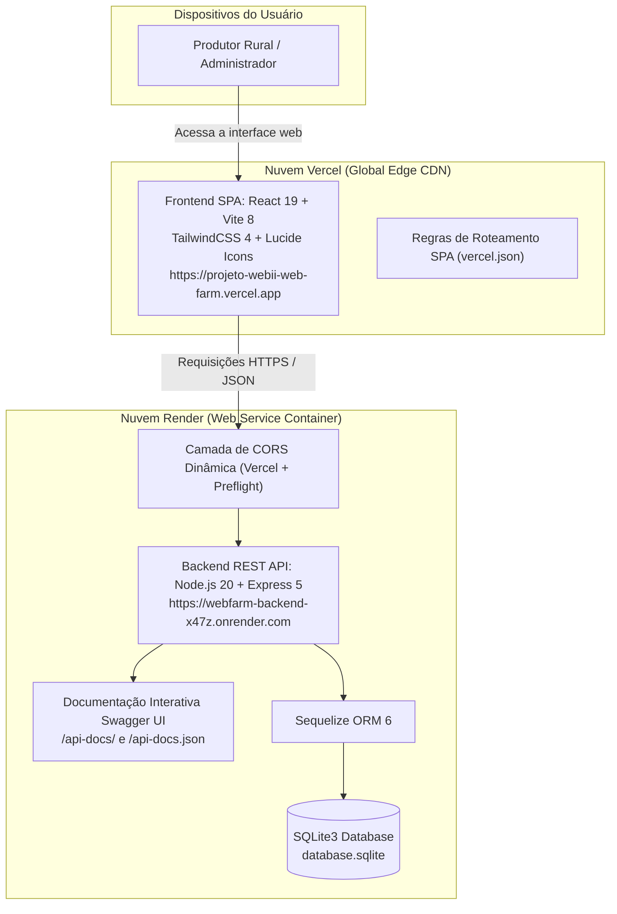
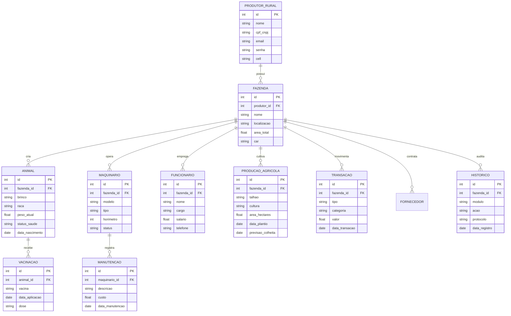
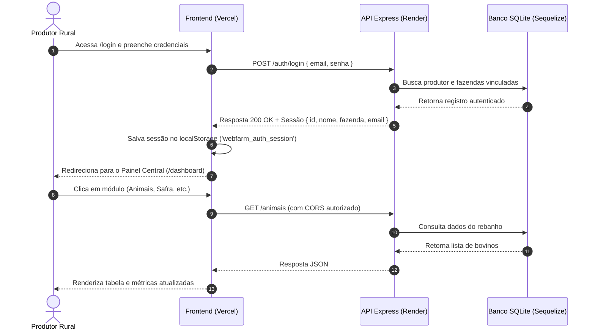
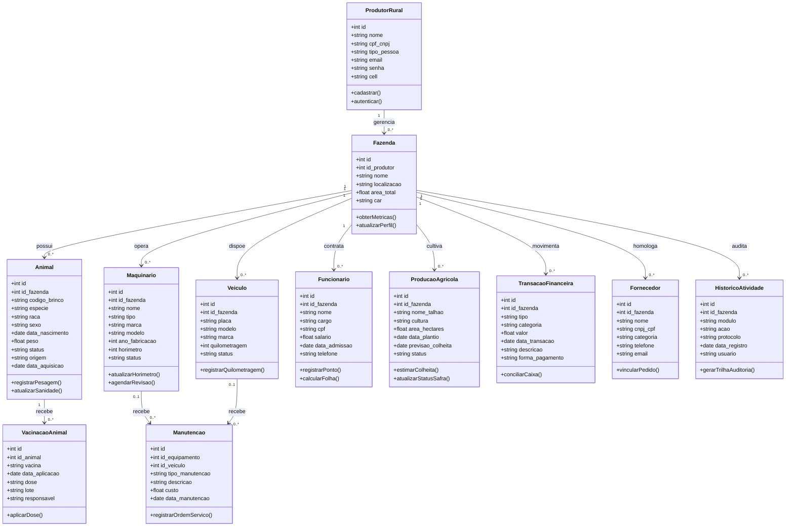

# 🌱 WebFarm 2.0 — Plataforma Integrada de Gestão Agropecuária

[](https://webfarm-backend-x47z.onrender.com/api-docs/)
[](https://projeto-webii-web-farm.vercel.app)
[](https://webfarm-backend-x47z.onrender.com)
[](https://nodejs.org/)
[](https://expressjs.com/)
[](https://react.dev/)
[](https://vitejs.dev/)
[](https://tailwindcss.com/)
[](https://www.sqlite.org/)
[](https://vitest.dev/)
[](https://jestjs.io/)

O **WebFarm 2.0** é uma solução web full-stack desenvolvida para modernizar, centralizar e simplificar a gestão de propriedades agropecuárias. O sistema consolida pecuária, lavouras, frotas de maquinários, equipe de campo e controle financeiro em uma interface interativa, responsiva e em tempo real.

Projeto desenvolvido para a disciplina de **Desenvolvimento Web II**.

---

## 🌐 Deploy em Produção & Acesso Online

| Serviço | Plataforma | Link Direto | Status |
| :--- | :--- | :--- | :--- |
| **Documentação Swagger UI** | Render | [https://webfarm-backend-x47z.onrender.com/api-docs/](https://webfarm-backend-x47z.onrender.com/api-docs/) | Online 🟢 |
| **Especificação OpenAPI (JSON)** | Render | [https://webfarm-backend-x47z.onrender.com/api-docs.json](https://webfarm-backend-x47z.onrender.com/api-docs.json) | Online 🟢 |
| **Aplicação Web (Frontend)** | Vercel | [https://projeto-webii-web-farm.vercel.app](https://projeto-webii-web-farm.vercel.app) | Online 🟢 |
| **API RESTful (Backend)** | Render | [https://webfarm-backend-x47z.onrender.com](https://webfarm-backend-x47z.onrender.com) | Online 🟢 |

---

## 📐 Diagramas do Sistema

### 1. Arquitetura da Solução & Nuvem



---

### 2. Diagrama Entidade-Relacionamento (Modelo de Dados)



---

### 3. Fluxo de Autenticação & Navegação



---

### 4. Diagrama de Classes (UML Class Diagram)



---

## 🚀 Funcionalidades e Módulos

### 1. 📊 Painel Central de Operações (Dashboard)
- Indicadores zootécnicos, agronômicos e financeiros consolidados.
- **Gráficos Interativos de Performance:**
  - **Evolução de Peso:** Curva de pesagens e Ganho Médio Diário (GMD) por raça e lote com tooltips dinâmicos e inteligentes.
  - **Fluxo de Caixa Mensal:** Comparativo entre receitas e despesas com identificação de meses superavitários.
  - **Produtividade de Safras:** Volume colhido vs metas por cultura.
- Tabela de atividades recentes com protocolo de auditoria e status.

### 2. 🐂 Pecuária & Gestão de Rebanho
- Cadastro de bovinos com raça, peso atual, data de nascimento, lote e status sanitário.
- Histórico de pesagens periódicas e monitoramento de desempenho.
- Registro e controle de vacinações veterinárias.

### 3. 🚜 Maquinários & Frotas do Campo
- Inventário de tratores, colheitadeiras, implementos e utilitários da fazenda.
- Controle de horímetros e odômetros para manutenção preventiva.
- Registro detalhado de revisões, troca de peças e custos vinculados.

### 4. 👥 Equipe & Colaboradores Rurais
- Gestão de funcionários da propriedade com cargos, salários e contatos.
- Registro de ponto diário, jornadas e histórico de atividades de campo.

### 5. 💰 Gestão Financeira & Fluxo de Caixa
- Lançamento de receitas operacionais (venda de grãos, gado, leite).
- Controle de despesas (combustível, insumos, sementes, folha de pagamento).
- Apuração automática de saldo líquido consolidado.

### 6. 🌾 Safras & Produção Agrícola
- Mapeamento e gestão de talhões e áreas produtivas em hectares.
- Controle por culturas agrícolas (Soja, Milho, Algodão, Café, etc.).
- Acompanhamento do ciclo produtivo: plantio, estimativa de colheita e status da safra.

### 7. 📑 Relatórios Analíticos & Exportação
- Visão tabular avançada com filtros cruzados de período, módulo e categoria.
- Resumos estatísticos automáticos com médias, totais e percentuais.
- Exportação de dados para relatórios gerenciais.

### 8. 🏡 Perfil da Fazenda & Governança
- Modal de perfil institucional da propriedade (nome, CNPJ/CPF, localização, área total, CAR).
- **Central de Ajuda Integrada:** Dúvidas frequentes de navegação e uso.
- **Suporte ao Produtor:** Abertura direta de chamados técnicos e canal oficial.
- **Especialista Agro:** Formulário de consultoria agronômica e zootécnica com acompanhamento técnico.
- **LGPD Agro:** Governança de dados, finalidade de coleta e encarregado de privacidade (DPO).
- **Status de Backup em Nuvem:** Indicador de integridade do banco de dados e disparo de backup manual.

### 9. 🧭 Página 404 Personalizada
- Rota de contingência temática agro (*"Erro 404 • Talhão Não Mapeado"*).
- Exibição da coordenada/rota inválida acessada.
- Atalhos rápidos com acesso direto aos módulos operacionais para rápida recuperação do usuário.

---

## 🛠️ Tecnologias Utilizadas

### Frontend
- **React 19** — Interface declarativa em componentes funcionais modernos e reativos.
- **Vite 8** — Empacotador e servidor de desenvolvimento ultra-rápido.
- **Tailwind CSS 4** — Design system com identidade visual agro (#237a32, esmeralda e tons de terra).
- **Lucide React** — Biblioteca de ícones vetoriais leves e consistentes.
- **Vitest & React Testing Library** — Testes unitários e de integração de componentes.

### Backend
- **Node.js 20+** — Ambiente de execução JavaScript assíncrono e escalável.
- **Express 5** — Framework RESTful para rotas, middlewares e validações.
- **Sequelize ORM 6** — Modelagem relacional e abstração de consultas SQL com SQLite.
- **SQLite 3 (v5.1.7)** — Banco de dados relacional leve, portátil e de alta performance.
- **Swagger UI & OpenAPI 3.0** — Documentação interativa em produção e desenvolvimento.
- **CORS** — Middleware dinâmico com suporte nativo para Vercel, Render e localhost.
- **Jest & Supertest** — Bateria completa de testes automatizados de endpoints e regras de negócio.

---

## 📂 Estrutura do Projeto

```text
Projeto_WEBII_WebFarm/
├── backend/
│   ├── src/
│   │   ├── config/          # Banco de dados (Sequelize) e especificação OpenAPI 3.0 (Swagger)
│   │   ├── controllers/     # Regras de negócio de cada módulo
│   │   ├── models/          # Modelos relacionais (Animais, Máquinas, Transações, etc.)
│   │   ├── routes/          # Rotas REST da aplicação
│   │   ├── app.js           # Inicialização e middlewares do Express (CORS, JSON, Docs)
│   │   └── server.js        # Inicialização do servidor HTTP
│   └── database.sqlite      # Arquivo do banco de dados SQLite local
├── frontend/
│   ├── public/              # Ativos estáticos e logotipos oficiais da marca
│   ├── src/
│   │   ├── components/      # Componentes reutilizáveis (Sidebar, Navbar, Modais, Gráficos)
│   │   ├── pages/           # Telas do sistema (Dashboard, Login, Registre, NotFound, etc.)
│   │   ├── services/        # Cliente de API Axios/Fetch configurado com VITE_API_URL
│   │   ├── test/            # Suítes de testes Vitest (Modais, 404, Rotas)
│   │   ├── App.jsx          # Roteamento SPA e gerenciador de sessão
│   │   └── index.css        # Folha de estilo global e tokens do Tailwind
│   ├── package.json
│   ├── vite.config.js
│   └── vercel.json          # Configuração de roteamento SPA na Vercel
├── tests/                   # Bateria de testes Jest de backend (Auth, Animais, CORS, Swagger)
├── render.yaml              # Manifesto de deploy no Render (Web Service Node)
├── vercel.json              # Configuração raiz para deploy da interface na Vercel
├── jest.config.cjs          # Configuração de testes do Jest
└── package.json             # Dependências e scripts do backend e da raiz
```

---

## 💻 Como Executar o Projeto Localmente

### Pré-requisitos
- [Node.js](https://nodejs.org/) versão 18 ou superior instalado.
- [Git](https://git-scm.com/) instalado.

### 1. Clonar o Repositório
```bash
git clone https://github.com/LucasRamosSilva-15/Projeto_WEBII_WebFarm.git
cd Projeto_WEBII_WebFarm
```

### 2. Configurar o Backend
Na raiz do projeto, instale as dependências:
```bash
npm install
```

Crie o arquivo de variáveis de ambiente `.env` na raiz:
```env
PORT=3000
FRONTEND_URL=http://localhost:5173
NODE_ENV=development
```

Inicie o servidor backend em modo de desenvolvimento:
```bash
npm run dev:backend
```
> O servidor estará rodando em: `http://localhost:3000`  
> A documentação Swagger estará disponível em: `http://localhost:3000/api-docs`

### 3. Configurar o Frontend
Abra um novo terminal e acesse a pasta `frontend`:
```bash
cd frontend
npm install
```

Crie o arquivo `.env` dentro da pasta `frontend`:
```env
VITE_API_URL=http://localhost:3000
```

Inicie o servidor de desenvolvimento do Vite:
```bash
npm run dev
```
> A aplicação estará acessível em: `http://localhost:5173`

---

## 🧪 Executando os Testes Automatizados

O projeto conta com **159 testes automatizados** distribuídos entre frontend e backend:

### Testes do Backend (Jest)
Executam na raiz do projeto e cobrem autenticação, regras de negócio de todos os módulos, documentação Swagger e cabeçalhos CORS:
```bash
npm test
```
*Resultado: 84 testes passando em 12 suítes.*

### Testes do Frontend (Vitest)
Executam na pasta `frontend` e cobrem renderização de componentes, modais interativos, página 404 e roteamento SPA:
```bash
cd frontend
npm test
```
*Resultado: 75 testes passando em 13 suítes.*

---

## 📖 Documentação da API (Swagger / OpenAPI 3.0)

A documentação interativa está disponível tanto em ambiente local quanto em **produção**:

- 🌐 **Swagger UI Online (Produção Render):** [https://webfarm-backend-x47z.onrender.com/api-docs/](https://webfarm-backend-x47z.onrender.com/api-docs/)
- 📋 **OpenAPI JSON Online (Produção Render):** [https://webfarm-backend-x47z.onrender.com/api-docs.json](https://webfarm-backend-x47z.onrender.com/api-docs.json)
- 💻 **Ambiente Local:** `http://localhost:3000/api-docs`

### Principais Endpoints da API

| Método | Endpoint | Descrição |
| :--- | :--- | :--- |
| `POST` | `/auth/login` | Autenticação por e-mail ou CPF/CNPJ |
| `POST` | `/auth/register` | Registro de novos produtores rurais |
| `GET` | `/dashboard/metricas` | Totais consolidados de animais, máquinas, safra e financeiro |
| `GET` / `POST` | `/animais` | Listagem e cadastro de animais do rebanho |
| `GET` / `PUT` / `DELETE`| `/animais/:id` | Consulta, atualização e exclusão de animal |
| `GET` / `POST` | `/maquinarios` | Listagem e cadastro de frotas e tratores |
| `GET` / `POST` | `/funcionarios` | Listagem e admissão de colaboradores |
| `GET` / `POST` | `/producoes` | Listagem e mapeamento de talhões e safras |
| `GET` / `POST` | `/transacoes` | Listagem e registro de receitas e despesas financeiras |
| `GET` / `POST` | `/historico` | Consulta de auditoria de atividades recentes do sistema |
| `GET` / `PUT` | `/fazendas/:id` | Consulta e atualização dos dados cadastrais da fazenda |
| `GET` / `POST` | `/fornecedores` | Gestão de fornecedores e parceiros agropecuários |
| `GET` / `POST` | `/manutencoes` | Ordens de manutenção vinculadas a frotas |
| `GET` / `POST` | `/vacinacoes` | Registro sanitário e vacinas por animal |

---

## 👥 Equipe e Autores

Projeto desenvolvido no âmbito da disciplina de **Desenvolvimento Web II**:

- **Artur Samuel Guedes da Silva**
- **Cauã Amaral de Araújo**
- **Darlan Nóbrega de Oliveira**
- **Jhenyffer Martins da Silva**
- **Lucas Ramos Silva**
- **Maria Alicya Silva Henrique**

---

## 📄 Licença

Este projeto é desenvolvido para fins acadêmicos e educacionais sob a licença **ISC**. Todos os direitos reservados aos respectivos autores.
